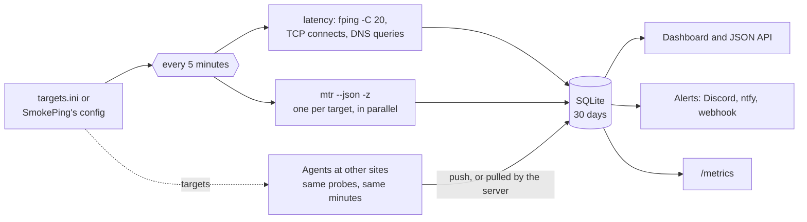

<p align="center">
  
</p>

<h1 align="center">smoketrace</h1>

<p align="center">
  <b>SmokePing, with the route behind every spike.</b><br>
  Latency, jitter and packet loss for every target, and an mtr traceroute taken in the same minutes,
  so a latency step and the route change that caused it sit on one screen, and in your alerts.
</p>

<p align="center">
  <a href="https://github.com/ST-DEVPT/smoketrace/actions/workflows/ci.yml"></a>
  <a href="https://github.com/ST-DEVPT/smoketrace/releases"></a>
  
  
  <a href="https://github.com/ST-DEVPT/smoketrace/pkgs/container/smoketrace"></a>
  
  <a href="LICENSE"></a>
</p>

<p align="center">
  <a href="#quick-start"><b>Quick start</b></a> ·
  <a href="#moving-from-smokeping">From SmokePing</a> ·
  <a href="#remote-agents">Remote agents</a> ·
  <a href="#alerts">Alerts</a> ·
  <a href="#prometheus-and-grafana">Prometheus</a> ·
  <a href="#reading-the-screen">Reading the screen</a> ·
  <a href="#configuration">Configuration</a> ·
  <a href="CHANGELOG.md">Changelog</a>
</p>

<p align="center">
  <picture>
    <source media="(prefers-color-scheme: light)" srcset="docs/overview-light.jpg">
    
  </picture>
</p>

## Why

SmokePing tells you *that* the latency to a target jumped at 05:10. It does not tell you *why*. The usual
answer is an `mtr` in cron writing text files, then lining up timestamps by hand, at night, while reading mtr
the way it is easiest to read wrong: a router that rate-limits ICMP looks like 50 % loss.

smoketrace measures and traces every target together, every five minutes. It keeps both, draws the route
under the latency on the same time axis, and reads the traceroute for you: which hops changed, which networks
the path now crosses, where real loss starts, and which "loss" is only a router saying no to ICMP. When
something changes for good, it tells you, with that reading in the message.

## What SmokePing alone does not show

| | SmokePing + `mtr` in cron | smoketrace |
| --- | --- | --- |
| Latency steps up at 05:10 | The step | The step, a line at 05:10 where the route changed, and the hops that changed |
| Whose network is it? | A list of IPs | The AS and the operator of every hop; "AS path changed" when the path moves to another network |
| 50 % loss on hop 4 of an mtr | Looks like an outage | Tagged **rate-limit**: it does not carry on to the destination |
| Where real loss starts | Read the mtr by eye | **Real loss starts here** on the first hop where it lasts to the end, in the dashboard and in the alert |
| Two paths taking turns | Invisible | Every path gets a letter; the route strip shows A B A B |
| Is it them or is it us? | Slaves: a Perl install and a shared secret per site | An agent container per site; every target shows how each site sees it |
| A host that drops ICMP | No latency at all | TCP connect time to its port, and an mtr over that same port |
| Running it | Perl, RRDtool, a web server, its own config language | One container, or one Python file with no dependencies; it reads your SmokePing config and history |

## At a glance

<p align="center"></p>

<table>
  <tr>
    <td valign="top" width="68%">
      <br><br>
      
    </td>
    <td valign="top" align="center">
      
    </td>
  </tr>
</table>

- **Every target on one screen**: status by shape and label (OK, warning, critical, down, no data), median,
  jitter, loss, a 24-hour sparkline on a shared time axis, the route changes and how each site sees it.
  Grouped, worst first, filtered by a click on a status, searched with <kbd>/</kbd>.
- **SmokePing's smoke**: the 20 pings of every round drawn as nested bands around the median, so the spread
  and the outliers show, not only an average.
- **Route and latency on one time axis**: a route strip under the chart, and a line at every change, in the
  new route's colour, through latency and loss.
- **Click any moment** for that round's traceroute, against the previous route or the previous round, hop by
  hop: changed, new, gone, silent, how much slower, and the AS and operator of each hop.
- **Reads mtr for you**: loss that stops at one hop is rate-limiting; loss that starts at a hop and reaches the
  destination is real, and is marked where it starts.
- **ICMP, TCP and DNS**: ping like fping, time a TCP connection to a port (for hosts that drop ICMP), or time a
  DNS server's answer; each with its traceroute over the same protocol.
- **Alerts that say why**: Discord, ntfy or any webhook, when a status or a route changes and holds; with the
  hop where loss starts, where the trace stops, the AS path, and what the other sites see.
- **Several vantage points**: agents at other sites probe the same targets; they push their rounds, or the
  server pulls them when an agent cannot reach it.
- **Prometheus and Grafana**: `/metrics` for every target and source, and a dashboard to import.
- **Moves you off SmokePing**: reads its config (targets, probes, slaves, step, pings) and imports its RRD
  history.
- **Made to be left alone**: one Python file, the standard library only, SQLite, 30 days kept; a multi-arch
  image with only `NET_RAW`, a read-only root and no-new-privileges; an optional password.
- **English and Portuguese, dark and light, desktop and phone**, the keyboard on the chart
  (<kbd>←</kbd> <kbd>→</kbd> <kbd>Enter</kbd>), and a table of every point.

## Quick start

### Docker

```bash
mkdir smoketrace && cd smoketrace
curl -O https://raw.githubusercontent.com/ST-DEVPT/smoketrace/main/docker-compose.yml
docker compose up -d
```

The first start writes an example `data/targets.ini`. Put your targets in it (the folder belongs to root, as
the container does: use `sudo`), and it is picked up before the next round, no restart needed. Open
`http://<docker-host>:8099` and sign in with the `PASSWORD` from the compose file (change it first); the first
round lands within five minutes. To update:
`docker compose pull && docker compose up -d`.

The compose file uses the host's network, so traceroutes start at your real gateway and not at Docker's
bridge, and it gives the container `NET_RAW` and nothing else.

> [!WARNING]
> Without `PASSWORD`, anyone who reaches port 8099 sees your targets and the routes to them. Set a password,
> keep it on a trusted network, or put it behind a reverse proxy. See [SECURITY.md](SECURITY.md).

### Try the demo

```bash
docker run --rm -p 8099:8099 -e DEMO=1 ghcr.io/st-devpt/smoketrace:latest
```

Or without Docker, on any OS: `python3 smoketrace.py --demo`. The demo seeds a week of seven targets seen from
two places: a route change with loss on the new path (Cloudflare DNS), two paths taking turns (Google DNS), a
router that rate-limits ICMP plus an hour of real loss (Quad9), a TCP check on a shop, and a server that just
went down for everyone.

### Without Docker (Debian, Ubuntu)

```bash
sudo apt install python3 fping mtr-tiny
sudo git clone https://github.com/ST-DEVPT/smoketrace /opt/smoketrace
sudo install -D -m 644 /opt/smoketrace/targets.ini /etc/smoketrace/targets.ini   # then put your targets in it
sudo cp /opt/smoketrace/smoketrace.service /etc/systemd/system/
sudo systemctl daemon-reload && sudo systemctl enable --now smoketrace
```

## Targets

`targets.ini`: one `[Group]` per section, one `Name = target` per line.

```ini
[LAN]
Router = 192.168.1.1

[Internet]
Cloudflare DNS = 1.1.1.1
Shop = tcp://shop.example.com:443          # TCP connect time; for hosts that drop ICMP
Resolver = dns://9.9.9.9/example.org       # how fast this DNS server answers this name
```

| Probe | Latency | Traceroute |
| --- | --- | --- |
| a host or address | `fping -C 20`, SmokePing's own flags | `mtr` over ICMP |
| `tcp://host:port` | the time to open a TCP connection, once a second, like SmokePing's TCPPing | `mtr -T` to that port |
| `dns://server/name` | the time to an answer from that server, once a second, like SmokePing's DNS probe | `mtr -T` to port 53 (a DNS server answers TCP; UDP probes would end in silence) |

Edits are picked up before the next round. With SmokePing's config instead, see below.

## Moving from SmokePing

smoketrace reads SmokePing's config as it is: no conversion, and you keep editing the same files. Mount the
folder it lives in and point `SMOKEPING_CONFIG` at that folder in `docker-compose.yml`:

```yaml
    volumes:
      - ./data:/data
      - /etc/smokeping:/etc/smokeping:ro           # SmokePing in a container? Its config folder, e.g.
                                                   # /DATA/smokeping/config:/etc/smokeping:ro
    environment:
      SMOKEPING_CONFIG: /etc/smokeping
```

The folder can hold one main `config` file (with `@include`s) or the split files that Debian and the
linuxserver/smokeping image use (`Probes`, `Slaves`, `Database`, `Targets`…). Paths inside the config are often
absolute for the machine or container SmokePing ran in, such as `@include /config/target/dns.conf` or
`secrets = /config/smokeping_secrets`: when such a path is not there, smoketrace looks for it in the mounted
folder (`/etc/smokeping/target/dns.conf`). An include that cannot be found is logged and skipped; the rest of the
config still loads.

The secrets file is often readable by SmokePing's user only. The container runs as root without
`CAP_DAC_OVERRIDE`, so if the log says it cannot read the secrets, either make the file readable to root
(`sudo chown root smokeping_secrets`) or give the agents' tokens in `AGENTS` instead.

| SmokePing | smoketrace |
| --- | --- |
| `*** Targets ***`, the `+` / `++` / `+++` tree | the targets; the tree becomes the groups, `menu` (or `title`) the names |
| `@include` | followed, relative to the including file |
| `FPing`, `FPing6`, `TCPPing` (`port`), `DNS` (`lookup`) and their subprobes | probed as ICMP, TCP and DNS; other probes (Curl, SSH…) and multi-host graphs are listed in the log and left out |
| `*** Slaves ***` and its `secrets` file | the agents: a slave's name, with its secret as the agent's `TOKEN`; `url = http://…` under a slave makes the server pull from it |
| `slaves = porto office` | which agents probe the target (inherited, like in SmokePing) |
| `nomasterpoll = yes` | the primary leaves the target to its agents |
| `step`, `pings` in `*** Database ***` | the round length and the pings per round, for the primary and every agent |
| `loss_warn`, `loss_crit` (in %), `latency_warn` (in ms) | smoketrace's own per-target limits, inherited down the tree |
| `*** Alerts ***`, `*** Presentation ***` | not used: [alerts](#alerts) are smoketrace's own |

The primary re-reads the config (every included file and the secrets) when one of them changes, before its next
round; the agents get the new list on theirs. A broken edit is logged and the last good config stays.

### Bring the history along

SmokePing keeps its history in RRD files; one command copies up to 30 days of it (median, loss and the spread of
every round, for the master and every slave) into smoketrace's database. It needs `rrdtool`, which every
SmokePing machine has, so the simplest is a throw-away container on that machine, once, before you start
smoketrace for the first time:

```bash
docker run --rm -v /var/lib/smokeping:/rrd:ro -v /etc/smokeping:/etc/smokeping:ro -v "$PWD/data:/data" \
  --entrypoint sh ghcr.io/st-devpt/smoketrace:latest -c "apk add -q rrdtool && \
  python smoketrace.py --import-rrd /rrd --smokeping /etc/smokeping --name home"
```

With the linuxserver/smokeping image, its data folder holds the RRD files: `-v /DATA/smokeping/data:/rrd:ro` and
`-v /DATA/smokeping/config:/etc/smokeping:ro`.

`--name` is the name the server's own probe will have (`NAME`); slave files (`Target~porto.rrd`) go to that
agent. Rounds older than three days come in hourly, as SmokePing stored them. Then stop SmokePing and its
slaves.

## Remote agents

An agent is the same image with a token. It never reads a config of its own: the server (the primary) gives it
its targets, the round length and the pings. It probes from where it runs and keeps up to a day of rounds while
the server is out of reach.

**1. On the server**, list the agents: with a SmokePing config they are its slaves and their secrets (see
above); otherwise give each agent a name and a long random token (`openssl rand -hex 24`):

```yaml
    environment:
      NAME: home
      AGENTS: porto=4f1c…a9e2,office=b7d0…13c5@http://office.lan:8100
```

**2. At each site**, run [`docker-compose.agent.yml`](docker-compose.agent.yml) with that site's token, in one of
two ways:

| | The agent pushes (default) | The server pulls |
| --- | --- | --- |
| When | the agent can reach the server | the server can reach the agent, not the other way round |
| On the agent | `SERVER: http://smoketrace.lan:8099` | `LISTEN: 0.0.0.0:8100` |
| In `AGENTS` | `porto=token` | `office=token@http://office.lan:8100` |
| Ports | none on the agent | 8100 on the agent, open to the server only |

**3. In the dashboard**, *Seen from* switches between `home`, `porto` and `office`, and the overview shows how
each of them sees every target: down from everywhere is the target; down from one place is the path from there.
An agent that goes quiet is an alert of its own.

Over the internet, use HTTPS (a reverse proxy) or a VPN such as WireGuard: the token travels with every round.

## Alerts

Set any of these and smoketrace sends an alert when a target's status or route changes **and holds for two
rounds** (so one bad round, or one odd trace, does not wake anyone up), when it recovers, and when an agent stops
or starts sending rounds again:

```yaml
    environment:
      DISCORD_WEBHOOK: https://discord.com/api/webhooks/…
      NTFY_URL: https://ntfy.sh/my-smoketrace-topic
      WEBHOOK_URL: https://example.com/hooks/smoketrace     # JSON: kind, level, title, lines, target, source, url
      PUBLIC_URL: https://smoketrace.example.com            # makes the alerts link to the target's page
```

An alert carries what you would look up first:

> **Cloudflare DNS is critical** · seen from home  
> Median 36.2 ms · loss 20 %  
> Was OK  
> Real loss starts at hop 5 (198.51.100.121, AS64498 Transit Two)  
> Seen from porto: OK

> **Route to Cloudflare DNS changed** · seen from home  
> hop 5 (198.51.100.121, AS64498): 198.51.100.21 → 198.51.100.121  
> AS path: AS64496 › AS64497 › AS64499 → AS64496 › AS64498 › AS64499

Route alerts can be turned off with `ALERT_ROUTES=0` (useful where ECMP makes routes take turns). Status limits
are 5 % and 20 % loss by default (`LOSS_WARN`, `LOSS_CRIT`), plus a warning when the median runs well above its
24-hour baseline; with SmokePing's config, `loss_warn`, `loss_crit` and `latency_warn` set them per target.

## Prometheus and Grafana

`/metrics` has, for every target and every source that probes it:

| Metric | |
| --- | --- |
| `smoketrace_median_seconds` | median round-trip time of the last round |
| `smoketrace_loss_ratio` | share of pings lost, 0 to 1 |
| `smoketrace_jitter_seconds` | mean difference between consecutive replies |
| `smoketrace_status` | 0 OK, 1 warning, 2 critical, 3 down, 4 no data |
| `smoketrace_route_changes_24h` | route changes over the last 24 hours |
| `smoketrace_last_round_timestamp_seconds` | when the last round was taken |

Labels: `target`, `name`, `group`, `host`, `probe`, `source`. With `METRICS_TOKEN` set (and always when
`PASSWORD` is set), Prometheus must send it:

```yaml
scrape_configs:
  - job_name: smoketrace
    scrape_interval: 60s
    authorization: {credentials: a-long-random-token}
    static_configs: [{targets: ["smoketrace.lan:8099"]}]
```

[`docs/grafana.json`](docs/grafana.json) is a dashboard to import: targets down, warnings, route changes, the worst
loss, then latency, loss, jitter and a status timeline, filtered by source, group and target.

## Reading the screen

The chart is three bands on one time axis:

- **Latency**: the line is the median of each round; the grey smoke behind it is its 20 pings, darker towards
  the middle. A thin, flat band is a healthy link, tall smoke is jitter, a lone whisker is one slow reply.
- **Loss**: the bar height is the share lost in that round; amber below the critical limit, red from it.
- **Route**: one letter per path (A, B, C…), kept for the target's whole history, so A coming back is still A.
  A line in the new route's colour marks each change across all three bands.

Click any moment (or <kbd>←</kbd> <kbd>→</kbd> and <kbd>Enter</kbd>) for its traceroute, against the
**previous route** (the default) or the **previous round**:

<p align="center"></p>

- **rate-limit**: loss on a hop that does not carry on to the destination. That router answers ICMP slowly or
  not at all; the packets going through it are fine.
- **real loss starts here**: the first hop from which the loss lasts to the last hop that answers. The problem
  is that hop, or the link into it.
- `???` is a hop that never answers ICMP. That is normal, and it never counts as a route change.
- Under every address: its AS and operator. "AS path changed" in the summary means the path now crosses other
  networks, not just other routers.
- When the destination stops answering, the page says which hop answered last.

## How it works



- **One round, one window.** Latency and traceroutes start together, so they describe the same minutes.
- **Latency** uses SmokePing's numbers: 20 samples a round, one a second; fping with SmokePing's own flags
  (`-C 20 -q -B1 -r1 -i10`). Each round keeps the median, the loss, the jitter (the mean difference between
  consecutive replies) and the 20 sorted replies for the smoke.
- **The same route** means the same IP at every TTL. A silent hop matches anything, so routers that skip ICMP
  now and then do not fake a change.
- **AS numbers** come from mtr (`-z`, which asks Team Cymru over DNS); their names are looked up once and kept.
  `ASN=0` turns both off.
- **Rows, not RRD.** Raw rounds stay in SQLite for 30 days; longer chart ranges are bucketed as they are read
  (600 points at most), so the smoke of a 30-day view is still the real spread.
- **Every source is kept apart.** The server's own probe and each agent have their own rows, routes and route
  letters; an agent's round is checked field by field before it is stored, and an agent checks every target it
  is given before it reaches a probe.
- **Status** comes from the last round: down at 100 % loss, critical from 20 %, warning from 5 % or when the
  median runs well above its 24-hour baseline (or over `latency_warn`), no data after three missed rounds.

### API

| Endpoint | Returns |
| --- | --- |
| `GET /api/overview?src=…` | every target as one source sees it, plus each source's status for it |
| `GET /api/target?id=…&range=86400&src=…` | points `[ts, median, loss, jitter, smoke]`, route segments, limits |
| `GET /api/trace?id=…&ts=…&vs=route&src=…` | the traceroute at `ts` (the latest without it), the one it is compared with (`vs=route` or `round`), the hop-by-hop diff and the AS names |
| `GET /metrics` | Prometheus text format |
| `GET /api/agent/targets`, `POST /api/agent/push` | for push agents, with `Authorization: Bearer <token>` |
| `POST /api/agent/pull` (on a pull agent) | for the server, with the agent's token |

## Configuration

Every option is an environment variable (and a flag):

| Variable | Default | |
| --- | --- | --- |
| `TARGETS` | `/data/targets.ini` in the image | [the targets](#targets) |
| `SMOKEPING_CONFIG` | none | read [SmokePing's config](#moving-from-smokeping) instead |
| `NAME` | `local` | what the dashboard calls the server's own probe |
| `PASSWORD` | none | sign-in for the dashboard and its API |
| `PUBLIC_URL` | none | the dashboard's address, for links in alerts |
| `AGENTS` | none | `name=token` (it pushes) or `name=token@http://agent:8100` (the server pulls), comma-separated; added to SmokePing's slaves |
| `DISCORD_WEBHOOK`, `NTFY_URL`, `WEBHOOK_URL` | none | where [alerts](#alerts) go |
| `ALERT_ROUTES` | `1` | `0`: alerts for status changes only |
| `LOSS_WARN`, `LOSS_CRIT` | `5`, `20` | loss limits in % (per target with SmokePing's config) |
| `METRICS_TOKEN` | none | bearer token for `/metrics` |
| `ASN` | `1` | `0`: no AS lookups |
| `DB` | `/data/smoketrace.db` in the image | the SQLite database |
| `BIND`, `PORT` | `0.0.0.0` in the image (else `127.0.0.1`), `8099` | where the server listens |
| `SERVER` | none | agent: push to this server |
| `LISTEN` | none | agent: wait for the server here, e.g. `0.0.0.0:8100` |
| `TOKEN` | none | agent: its token |
| `IMPORT_RRD` | none | one-off: [import SmokePing's RRD files](#bring-the-history-along) from this folder |
| `DEMO` | off | `1`: synthetic data, no probes |

The round length (300 s) and pings per round (20) are SmokePing's defaults; SmokePing's `*** Database ***` changes
them. Data is kept for 30 days.

## Limits

- mtr cannot pin a flow, so ECMP (several equal-cost paths) can show as routes taking turns;
  `ALERT_ROUTES=0` keeps such flaps out of your alerts.
- No HTTP (Curl) probe yet.
- The password protects the dashboard; put it behind HTTPS if it leaves your network.

## Development

```bash
python3 test_smoketrace.py      # parsers, routes, probes over loopback, sign-in, metrics, agents, alerts
python3 smoketrace.py --demo    # the dashboard against a week of synthetic data
python3 docs/screenshots.py     # regenerates the images in docs/ (needs Playwright)
```

CI runs the tests on Python 3.10 to 3.14, the demo end to end, a real round of fping, TCP, DNS and mtr against the
runner itself, an RRD import through rrdtool, and the image as shipped: a server and an agent, each with only
`NET_RAW`, probing for real.

<p align="center"><sub>Made in Portugal 🇵🇹 by <a href="https://github.com/ST-DEVPT">ST-DEVPT</a> · tools for the homelab, built to be left alone.</sub></p>
