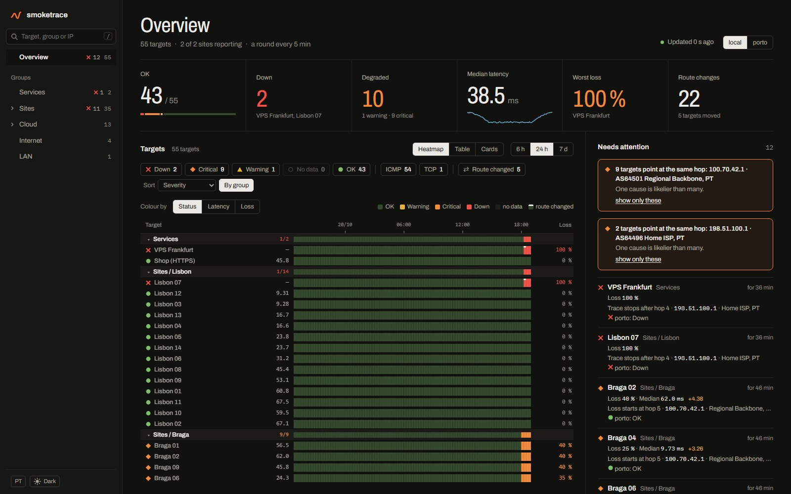
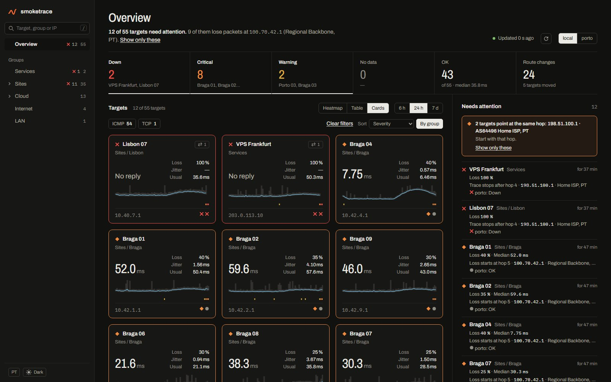
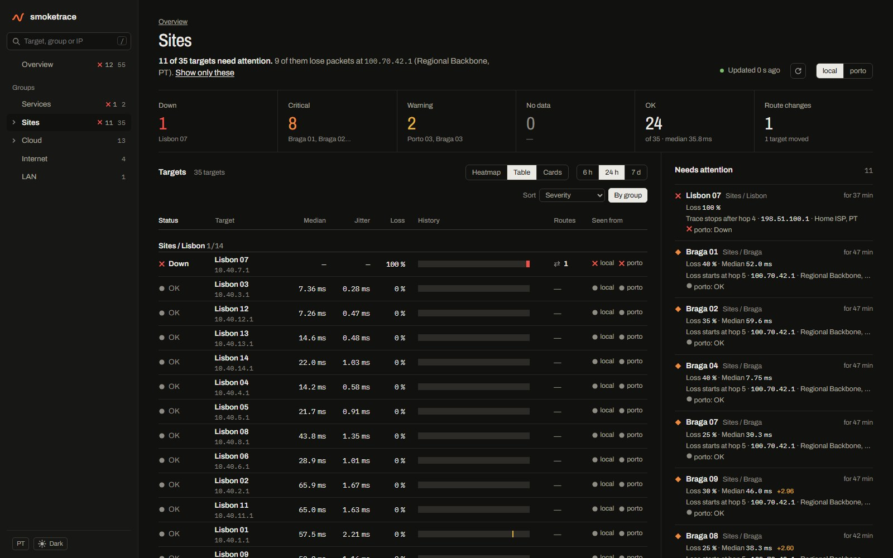
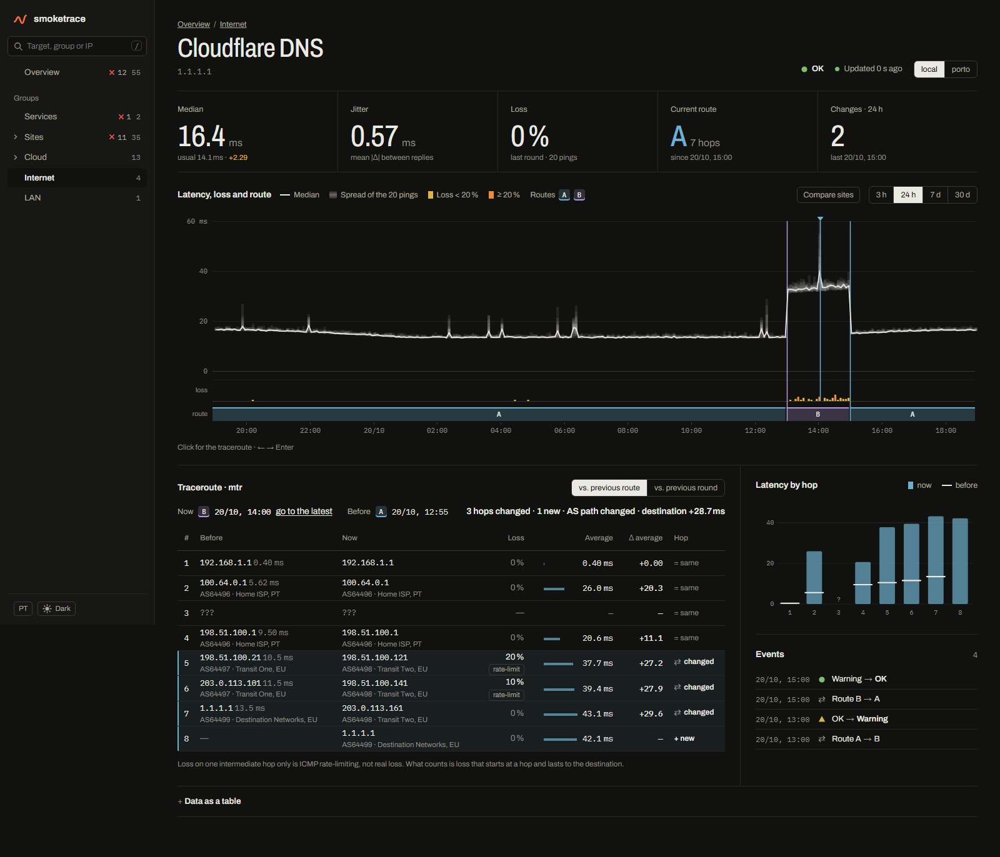
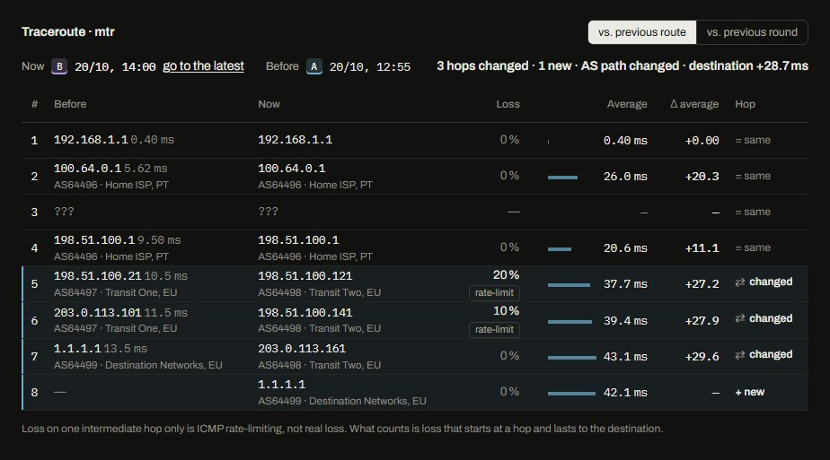
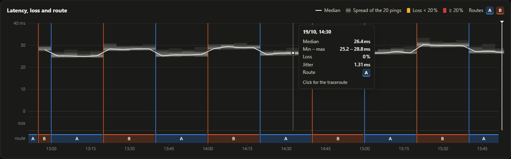
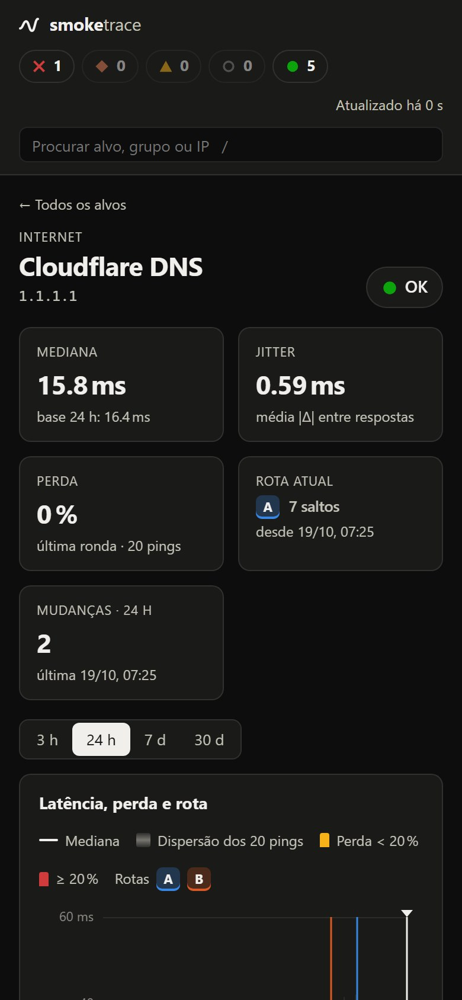

<p align="center">
  
</p>

<h1 align="center">smoketrace</h1>

<p align="center">
  <b>SmokePing, with the route behind every spike.</b><br>
  Latency, jitter and packet loss for every target, and an mtr traceroute taken in the same minutes,
  so a latency step and the route change that caused it sit on one screen, and in your alerts.
</p>

<p align="center">
  <a href="https://github.com/ST-DEVPT/smoketrace/actions/workflows/ci.yml"></a>
  <a href="https://github.com/ST-DEVPT/smoketrace/releases"></a>
  
  
  <a href="https://github.com/ST-DEVPT/smoketrace/pkgs/container/smoketrace"></a>
  <a href="LICENSE"></a>
</p>

<p align="center">
  <a href="#install"><b>Install</b></a> ·
  <a href="#add-a-remote-site">Remote sites</a> ·
  <a href="#alerts">Alerts</a> ·
  <a href="#every-option">Every option</a> ·
  <a href="#common-problems">Common problems</a> ·
  <a href="docs/smokeping.md">From SmokePing</a> ·
  <a href="docs/how-it-works.md">How it works</a> ·
  <a href="CHANGELOG.md">Changelog</a>
</p>

<p align="center">
  <picture>
    <source media="(prefers-color-scheme: light)" srcset="docs/overview-light.jpg">
    
  </picture>
</p>

## What it does

SmokePing tells you *that* the latency to a target jumped at 05:10. smoketrace also tells you *why*: every five
minutes it pings each target 20 times and takes a traceroute in the same minutes, keeps both, and reads the
traceroute for you.

- **The overview answers first**: "12 of 55 targets need attention. 9 of them lose packets at 100.70.42.1
  (Regional Backbone)", with a link that shows only those nine. Groups on the left, a heatmap where only trouble
  has colour, and a list of what needs attention.
- **Each target's page** puts latency, loss and the route on one time axis. Click any moment for its traceroute
  against the previous route: both routes are drawn as lines beside the hops, so you see where they part.
- **It reads mtr for you**: loss on one hop that the next hops do not share is ICMP rate-limiting, not an
  outage; loss that starts at a hop and lasts to the end is real, and is marked where it starts. Every hop shows
  its network (AS and operator).
- **Several sites**: agents at other places probe the same targets, so you can tell "the target is down" from
  "the path from here is broken". The **Sites** page shows where each one is: its public address, the network
  and country that address is announced from, and the place you type in.
- **Alerts** on Discord, ntfy or any webhook that say why: the hop where loss starts, the route that changed,
  what the other sites see. **Prometheus** metrics and a Grafana dashboard.
- **Edit targets on the page**, or keep a text file, or point it at SmokePing's config as it is and import
  SmokePing's history.
- One container (or one Python file with no dependencies), English and Portuguese, dark and light, desktop and
  phone.

<table>
  <tr>
    <td valign="top" width="50%"></td>
    <td valign="top" width="50%"></td>
  </tr>
</table>

<p align="center"></p>

<table>
  <tr>
    <td valign="top" width="68%">
      <br><br>
      
    </td>
    <td valign="top" align="center">
      
    </td>
  </tr>
</table>

## Install

You need Docker with Compose. Three steps:

**1. Get the compose file** and set a password in it (open it in any editor, change `PASSWORD: change-me`):

```bash
mkdir smoketrace && cd smoketrace
curl -O https://raw.githubusercontent.com/ST-DEVPT/smoketrace/main/docker-compose.yml
```

**2. Start it:**

```bash
docker compose up -d
```

**3. Open** `http://<this-host>:8099`, sign in, and go to **Targets** → **Add target**. The first round lands
within five minutes.

That is all. [`docker-compose.yml`](docker-compose.yml) lists every option with a comment; the short version is:

```yaml
services:
  smoketrace:
    image: ghcr.io/st-devpt/smoketrace:latest
    container_name: smoketrace
    restart: unless-stopped
    network_mode: host                 # traceroutes start at your real gateway
    volumes:
      - ./data:/data                   # database and targets: back up this folder
    environment:
      TZ: Europe/Lisbon
      NAME: home                       # what the page calls this server
      PASSWORD: change-me
    read_only: true
    cap_drop: [ALL]
    cap_add: [NET_RAW]                 # fping and mtr need raw ICMP, nothing else
    security_opt: ["no-new-privileges:true"]
```

**Update** to a new version: `docker compose pull && docker compose up -d`. The version you run is shown in the
corner of the page.

**Try it first** with made-up data, no setup: `docker run --rm -p 8099:8099 -e DEMO=1 ghcr.io/st-devpt/smoketrace:latest`,
then open `http://localhost:8099`.

> [!WARNING]
> Without `PASSWORD`, anyone who reaches port 8099 sees your targets and the routes to them, and the Targets page
> stays read-only. Set a password, and put the page behind HTTPS if it is reachable from the internet
> ([below](#behind-https)). See [SECURITY.md](SECURITY.md).

## Add targets

On the **Targets** page: **Add target**, then a group, a name and an address. The address can be:

| Address | Latency | Traceroute |
| --- | --- | --- |
| `1.1.1.1` or `host.example.com` | 20 pings, like SmokePing's FPing | mtr over ICMP |
| `tcp://shop.example.com:443` | the time to open a TCP connection, for hosts that drop ping | mtr over TCP to that port |
| `dns://9.9.9.9/example.org` | how fast that DNS server answers that name | mtr over TCP to port 53 |

Groups nest with ` / `: `Sites / Lisbon` puts Lisbon under Sites. Each target can be left to some sites only, and
have its own loss and latency limits. Changes are probed from the next round.

The page keeps the list in `data/targets.json`. You can also write `data/targets.ini` by hand (the first start
writes an example), one `[Group]` per section and one `Name = address` per line; the page takes it over at its
first change. Coming from SmokePing? smoketrace can [read its config as it is](docs/smokeping.md).

## Add a remote site

An agent is the same image at another place (another office, a VPS, a friend's house). It has no config of its
own: the server tells it what to probe.

**1. Make a token** (any long random string):

```bash
openssl rand -hex 24
```

**2. On the server**, add the site to `AGENTS` in `docker-compose.yml` and restart it (`docker compose up -d`):

```yaml
      AGENTS: porto=the-token-from-step-1
```

**3. At the site**, get [`docker-compose.agent.yml`](docker-compose.agent.yml), put the **same token** in
`TOKEN` and the server's address in `SERVER`, and start it:

```yaml
    environment:
      TZ: Europe/Lisbon
      TOKEN: the-token-from-step-1
      SERVER: https://smoketrace.example.com
```

```bash
docker compose -f docker-compose.agent.yml up -d
```

After its first round, *porto* appears under **Seen from** at the top of the page. **All**, the default, shows
every site at once: each target takes the status of the site where it is worst, with that site's figures, and its
page draws every site on the chart. Pick a site to see the targets from there only.

The **Sites** page lists every site with its public address, its network (AS) and its country. Each site finds
its own address once an hour with one DNS question to Google's name servers (`o-o.myaddr.l.google.com`), and the
network and country come from Team Cymru, like the operators on the hops. Where that is wrong (a VPN, a VPS
registered elsewhere), type the place, the country or the provider on the page: what you type wins. Agents older
than 0.13 send no address; the server then uses the one their push comes from, when it is a public one.

`AGENTS` goes on the **server** (its list of sites); `TOKEN` and `SERVER` go on the **agent**. If the agent cannot
reach the server but the server can reach the agent, turn it around: on the agent replace `SERVER` with
`LISTEN: 0.0.0.0:8100`, open port 8100 to the server only, and on the server write
`AGENTS: porto=token@http://porto-host:8100`. Over the internet, use HTTPS or a VPN: the token travels with every
round.

## Alerts

Add any of these to the server's `environment:` and restart:

```yaml
      DISCORD_WEBHOOK: https://discord.com/api/webhooks/...
      NTFY_URL: https://ntfy.sh/my-smoketrace-topic
      WEBHOOK_URL: https://example.com/hooks/smoketrace   # a JSON POST: kind, level, title, lines, target, source, url
      PUBLIC_URL: https://smoketrace.example.com          # so alerts link to the target's page
```

An alert is sent when a target's status or route changes **and holds for two rounds**, when it recovers, and when
a site stops sending rounds. It carries what you would look up first:

> **Cloudflare DNS is critical** · seen from home  
> Median 36.2 ms · loss 20 %  
> Was OK  
> Real loss starts at hop 5 (198.51.100.121, AS64498 Transit Two)  
> Seen from porto: OK

`ALERT_ROUTES: "0"` keeps route changes out of the alerts (useful where load-balanced paths take turns).

## Prometheus and Grafana

`http://<server>:8099/metrics` has, for every target and site: `smoketrace_median_seconds`,
`smoketrace_loss_ratio`, `smoketrace_jitter_seconds`, `smoketrace_status` (0 OK, 1 warning, 2 critical, 3 down,
4 no data), `smoketrace_route_changes_24h` and `smoketrace_last_round_timestamp_seconds`, labelled `target`,
`name`, `group`, `host`, `probe` and `source`. With a `PASSWORD` set, give Prometheus a `METRICS_TOKEN`:

```yaml
scrape_configs:
  - job_name: smoketrace
    scrape_interval: 60s
    authorization: {credentials: the-metrics-token}
    static_configs: [{targets: ["smoketrace.lan:8099"]}]
```

[`docs/grafana.json`](docs/grafana.json) is a dashboard to import.

## Every option

Everything is an environment variable in `docker-compose.yml` (or a flag without Docker: `--name`, `--port`…).

**Server**

| Option | Default | What it does |
| --- | --- | --- |
| `NAME` | `local` | What the page calls this server's own probe. Letters, digits, `_` and `-`. |
| `PASSWORD` | none | Sign-in for the page and its API. Needed to edit targets on the page. |
| `PUBLIC_URL` | none | The page's address, e.g. `https://smoketrace.example.com`, for links in alerts. |
| `PORT` | `8099` | The port the page listens on. |
| `BIND` | `0.0.0.0` in Docker, `127.0.0.1` otherwise | The address the page listens on. |
| `TZ` | UTC | The time zone for the logs, e.g. `Europe/Lisbon`. |
| `AGENTS` | none | The remote sites: `porto=token,office=token`. `name=token@http://site:8100` when the server fetches from the site. A site added later probes every target; untick it on a target to leave that one out. |
| `SMOKEPING_CONFIG` | none | Read SmokePing's config from this folder or file ([details](docs/smokeping.md)). |
| `TARGETS` | `/data/targets.ini` | The hand-written targets file; the page keeps its list next to it, in `targets.json`. |
| `DB` | `/data/smoketrace.db` | The database. 30 days are kept. |

**Alerts**

| Option | Default | What it does |
| --- | --- | --- |
| `DISCORD_WEBHOOK` | none | A Discord channel webhook. |
| `NTFY_URL` | none | An ntfy topic, e.g. `https://ntfy.sh/your-topic`. |
| `WEBHOOK_URL` | none | Any URL; every alert is POSTed to it as JSON. |
| `ALERT_ROUTES` | `1` | `0`: alerts for status changes only. |
| `LOSS_WARN` | `10` | Loss in % for a warning (2 of 20 pings). Per target on the Targets page. |
| `LOSS_CRIT` | `20` | Loss in % for critical (4 of 20 pings). Per target on the Targets page. |

**Prometheus and tuning**

| Option | Default | What it does |
| --- | --- | --- |
| `METRICS_TOKEN` | none | `/metrics` asks for it as a bearer token (and is closed without it when `PASSWORD` is set). |
| `STEP` | `300` | Seconds between two rounds of pings (`180`, `3m`), 60 to 3600. Wins over SmokePing's `step`. Agents follow the server. |
| `TRACE_STEP` | every round | Seconds between two traceroutes of a target (`900`, `15m`), rounded to whole rounds. A target that starts losing pings is traced the next round anyway. Agents follow the server. |
| `TRACE_PARALLEL` | `16` | Traceroutes at once, 1 to 64. Fewer use less CPU; more trace every target more often. |
| `ASN` | `1` | `0`: no AS numbers and operator names on hops, and no public address lookups for the Sites page. |

**Agent** (in `docker-compose.agent.yml`)

| Option | Default | What it does |
| --- | --- | --- |
| `TOKEN` | none | This site's token, the same one the server lists for it in `AGENTS`. Required. |
| `SERVER` | none | The server's address; the agent sends its rounds there. |
| `LISTEN` | none | Instead of `SERVER`: wait for the server to fetch the rounds, e.g. `0.0.0.0:8100`. |
| `TRACE_PARALLEL`, `ASN`, `TZ` | as above | As on the server. |

**One-off**

| Option | What it does |
| --- | --- |
| `DEMO=1` | Made-up data and no probes, to try the page. |
| `IMPORT_RRD` | Import SmokePing's history from this folder ([how](docs/smokeping.md#bring-the-history-along)). |

The round length (5 minutes) and the pings per round (20) are SmokePing's defaults; with SmokePing's config, its
`*** Database ***` sets them, and `STEP` wins over both. For pings every 3 minutes and a traceroute of each target
every 15: `STEP: 3m` and `TRACE_STEP: 15m`.

## Common problems

**The agent stops with "an agent needs its token in TOKEN".** `TOKEN` is missing on the agent. It is the same token
that follows the site's name in the server's `AGENTS`. `AGENTS` itself belongs on the server, not on the agent.

**The site never shows under "Seen from".** Check the agent's log (`docker logs smoketrace-agent`).
`HTTP Error 401`: the token on the agent differs from the one in the server's `AGENTS`, or the server was not
restarted after `AGENTS` changed. `cannot fetch targets` with a connection error: `SERVER` is wrong or blocked;
open that address in a browser from the site.

**An agent logs "can't fork", "Unable to start net module" or "can't start new thread".** Update the image to
0.11 or later. Before 0.11, each mtr killed for running too long left its helper processes behind until the
container could not start any more; `init: true` in the compose service also cures it.

**The Targets page is read-only.** Set `PASSWORD` and sign in. Without a sign-in, anyone who opens the page could
change what your server probes.

**No data after five minutes.** `docker logs smoketrace` says what the round did. "latency probe failed" or a round
that took longer than the step usually means the machine is overloaded: lower `TRACE_PARALLEL`.

**"cannot read" a SmokePing file.** See [Moving from SmokePing](docs/smokeping.md): paths in its config are found
in the mounted folder, and the secrets file must be readable by root.

**Back up or move it.** Everything is in the `data` folder: stop the container, copy the folder, start it again.

### Behind HTTPS

To reach the page from the internet, put it behind a reverse proxy. With [Caddy](https://caddyserver.com):

```
smoketrace.example.com {
    reverse_proxy 127.0.0.1:8099
}
```

### Without Docker (Debian, Ubuntu)

```bash
sudo apt install python3 fping mtr-tiny
sudo git clone https://github.com/ST-DEVPT/smoketrace /opt/smoketrace
sudo cp /opt/smoketrace/smoketrace.service /etc/systemd/system/
sudo systemctl daemon-reload && sudo systemctl enable --now smoketrace
```

Options go in the service file as `Environment=NAME=home` lines (`sudo systemctl edit smoketrace`).

## More

- [How it works](docs/how-it-works.md): reading the screen, the rounds, the API, the limits.
- [Moving from SmokePing](docs/smokeping.md): its config as it is, and its history.
- [SECURITY.md](SECURITY.md) and the [changelog](CHANGELOG.md).

## Development

```bash
python3 test_smoketrace.py      # parsers, routes, probes over loopback, sign-in, metrics, agents, alerts, editing
python3 smoketrace.py --demo    # the page against a week of made-up data
python3 test_ui.py              # the page in Chromium against the demo: navigation, slowed answers, editing
python3 docs/screenshots.py     # regenerates the images in docs/ (needs Playwright)
```

CI runs the tests on Python 3.10 to 3.14, the demo end to end, the page in a real browser, a real round of fping,
TCP, DNS and mtr against the runner itself, an RRD import through rrdtool, and the image as shipped: a server and
an agent, each with only `NET_RAW`, probing for real.

<p align="center"><sub>Made in Portugal 🇵🇹 by <a href="https://github.com/ST-DEVPT">ST-DEVPT</a> · tools for the homelab, built to be left alone.</sub></p>
