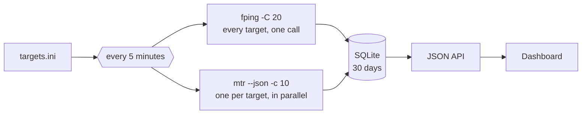

<p align="center">
  
</p>

<h1 align="center">smoketrace</h1>

<p align="center">
  <b>SmokePing, with the route behind every spike.</b><br>
  Latency, jitter and packet loss for every target, and an mtr traceroute taken in the same minutes,
  so a latency step and the route change that caused it sit on one screen.
</p>

<p align="center">
  <a href="https://github.com/ST-DEVPT/smoketrace/actions/workflows/ci.yml"></a>
  <a href="https://github.com/ST-DEVPT/smoketrace/releases"></a>
  
  
  
  <a href="LICENSE"></a>
</p>

<p align="center">
  <a href="#quick-start"><b>Quick start</b></a> ·
  <a href="#reading-the-screen">Reading the screen</a> ·
  <a href="#how-it-works">How it works</a> ·
  <a href="#configuration">Configuration</a> ·
  <a href="#limits">Limits</a> ·
  <a href="CHANGELOG.md">Changelog</a>
</p>

<p align="center">
  <picture>
    <source media="(prefers-color-scheme: light)" srcset="docs/overview-light.jpg">
    
  </picture>
</p>

## Why

SmokePing tells you *that* the latency to a target jumped at 05:10. It does not tell you *why*. The usual
answer is an `mtr` in cron writing text files, then lining up timestamps by hand, at night, while reading mtr
the way it is easiest to read wrong: a router that rate-limits ICMP looks like 50 % loss.

smoketrace runs `fping` and `mtr` together, every five minutes, for every target. It keeps both, draws the
route under the latency on the same time axis, and reads the traceroute for you: which hops changed, where
real loss starts, and which "loss" is only a router saying no to ICMP.

## What SmokePing alone does not show

| | SmokePing + `mtr` in cron | smoketrace |
| --- | --- | --- |
| Latency steps up at 05:10 | The step | The step, a line at 05:10 where the route changed, and the hops that changed |
| 50 % loss on hop 4 of an mtr | Looks like an outage | Tagged **rate-limit**: it does not carry on to the destination |
| Where real loss starts | Read the mtr by eye | **Real loss starts here** on the first hop where it lasts to the end |
| Two paths taking turns | Invisible | Every path gets a letter; the route strip shows A B A B |
| The target stops answering | A red graph | Plus the last hop that still answers |
| Running it | Perl, RRDtool, a web server, its own config language | One Python file, no dependencies, SQLite, a systemd unit |

## At a glance

<p align="center"></p>

<table>
  <tr>
    <td valign="top" width="68%">
      <br><br>
      
    </td>
    <td valign="top" align="center">
      
    </td>
  </tr>
</table>

- **Every target on one screen**: status by shape and label (OK, warning, critical, down, no data), median,
  jitter, loss, a 24-hour sparkline on a shared time axis and the route changes. Grouped, worst first,
  filtered by a click on a status, searched with <kbd>/</kbd>.
- **SmokePing's smoke**: the 20 pings of every round drawn as nested bands around the median, so the spread
  and the outliers show, not only an average.
- **Route and latency on one time axis**: a route strip under the chart, and a line at every change, in the
  new route's colour, through latency and loss.
- **Click any moment** for that round's traceroute, against the previous route or the previous round, hop by
  hop: changed, new, gone, silent, and how much slower.
- **Reads mtr for you**: loss that stops at one hop is rate-limiting; loss that starts at a hop and reaches the
  destination is real, and is marked where it starts.
- **Made to be left alone**: one Python file, the standard library only, SQLite, 30 days kept, a hardened
  systemd unit (dynamic user, `CAP_NET_RAW` only).
- **Dark and light, desktop and phone**, the keyboard on the chart (<kbd>←</kbd> <kbd>→</kbd> <kbd>Enter</kbd>),
  and a table of every point.

## Quick start

### Try the demo (any OS, no probes)

```bash
git clone https://github.com/ST-DEVPT/smoketrace && cd smoketrace
python3 smoketrace.py --demo
```

Open <http://127.0.0.1:8099>. The demo seeds a week of six targets: a route change with loss on the new path
(Cloudflare DNS), two paths taking turns (Google DNS), a router that rate-limits ICMP plus an hour of real loss
(Quad9), and a server that just went down.

### Run it for real (Debian, Ubuntu)

```bash
sudo apt install python3 fping mtr-tiny
sudo git clone https://github.com/ST-DEVPT/smoketrace /opt/smoketrace
sudo install -D -m 644 /opt/smoketrace/targets.ini /etc/smoketrace/targets.ini   # then put your targets in it
sudo cp /opt/smoketrace/smoketrace.service /etc/systemd/system/
sudo systemctl daemon-reload && sudo systemctl enable --now smoketrace
```

Open `http://<host>:8099`; the first round lands within five minutes. To update: `git -C /opt/smoketrace pull`
and `systemctl restart smoketrace`.

> [!WARNING]
> There is no login. The unit listens on every interface: keep it on a trusted network, or behind a reverse
> proxy with authentication. See [SECURITY.md](SECURITY.md).

Without systemd: `python3 smoketrace.py --targets targets.ini --bind 0.0.0.0`. If fping or mtr say
*permission denied*, give them raw sockets (`sudo setcap cap_net_raw+ep $(which fping)`, same for
`mtr-packet`) or run it as root.

## Configuration

`targets.ini`: one `[Group]` per section, one `Name = host` per line.

```ini
[LAN]
Router = 192.168.1.1

[Internet]
Cloudflare DNS = 1.1.1.1
Google DNS = 8.8.8.8
```

| Option | Default | |
| --- | --- | --- |
| `--targets` | `targets.ini` next to the script | the file above |
| `--db` | `smoketrace.db` next to the script | the SQLite database |
| `--bind` | `127.0.0.1` | address to listen on |
| `--port` | `8099` | |
| `--demo` | off | synthetic data, no probes |

The rest are constants at the top of [`smoketrace.py`](smoketrace.py), set to SmokePing's defaults:

| Constant | Default | |
| --- | --- | --- |
| `STEP` | 300 s | one round every five minutes |
| `PINGS` | 20 | pings per target per round |
| `MTR_CYCLES` | 10 | probes per hop per round |
| `RETENTION_DAYS` | 30 | |
| `LOSS_WARN`, `LOSS_CRIT` | 5 %, 20 % | one lost ping of 20 is 5 % |
| `LAT_FACTOR`, `LAT_MARGIN` | 1.5, 10 ms | warning when the median is above the 24 h baseline × 1.5 + 10 ms |

## Reading the screen

The chart is three bands on one time axis:

- **Latency**: the line is the median of each round; the grey smoke behind it is its 20 pings, darker towards
  the middle. A thin, flat band is a healthy link, tall smoke is jitter, a lone whisker is one slow reply.
- **Loss**: the bar height is the share lost in that round; amber under 20 %, red from 20 %.
- **Route**: one letter per path (A, B, C…), kept for the target's whole history, so A coming back is still A.
  A line in the new route's colour marks each change across all three bands.

Click any moment (or <kbd>←</kbd> <kbd>→</kbd> and <kbd>Enter</kbd>) for its traceroute, against the
**previous route** (the default) or the **previous round**:

<p align="center"></p>

- **rate-limit**: loss on a hop that does not carry on to the destination. That router answers ICMP slowly or
  not at all; the packets going through it are fine.
- **real loss starts here**: the first hop from which the loss lasts to the last hop that answers. The problem
  is that hop, or the link into it.
- `???` is a hop that never answers ICMP. That is normal, and it never counts as a route change.
- When the destination stops answering, the page says which hop answered last.

## How it works



- **One round, one window.** fping and the mtr runs start together, so the latency and the route describe the
  same minutes.
- **fping** runs with SmokePing's own flags (`-C 20 -q -B1 -r1 -i10`). Each round keeps the median, the loss,
  the jitter (the mean difference between consecutive replies) and the 20 sorted replies for the smoke.
- **The same route** means the same IP at every TTL. A silent hop matches anything, so routers that skip ICMP
  now and then do not fake a change.
- **Rows, not RRD.** Raw rounds stay in SQLite for 30 days; longer chart ranges are bucketed as they are read
  (600 points at most), so the smoke of a 30-day view is still the real spread.
- **Status** comes from the last round: down at 100 % loss, critical from 20 %, warning from 5 % or when the
  median runs well above its 24-hour baseline, no data after three missed rounds.

### API

| Endpoint | Returns |
| --- | --- |
| `GET /api/overview` | every target: status, last round, 24 h baseline, sparkline, route changes |
| `GET /api/target?id=…&range=86400` | points `[ts, median, loss, jitter, smoke]`, route segments, thresholds |
| `GET /api/trace?id=…&ts=…&vs=route` | the traceroute at `ts` (the latest without it), the one it is compared with (`vs=route` or `round`) and the hop-by-hop diff |

## Limits

- One vantage point, the machine it runs on: no SmokePing-style slaves.
- No alerts yet; the overview, the tab title and the favicon carry the worst state.
- mtr's JSON keeps one IP per hop, so ECMP (several equal-cost paths) shows as routes taking turns.
  paris-traceroute would pin the flow.
- No login (see the warning above).
- The interface is in Portuguese (pt-PT).

## Development

```bash
python3 test_smoketrace.py      # parsers, route logic, diff, status: no network
python3 smoketrace.py --demo    # the dashboard against a week of synthetic data
python3 docs/screenshots.py     # regenerates the images in docs/ (needs Playwright)
```

CI runs the tests on Python 3.10 to 3.14, the demo end to end, and a real round of fping and mtr
against the runner itself.

<p align="center"><sub>Made in Portugal 🇵🇹 by <a href="https://github.com/ST-DEVPT">ST-DEVPT</a> · tools for the homelab, built to be left alone.</sub></p>
