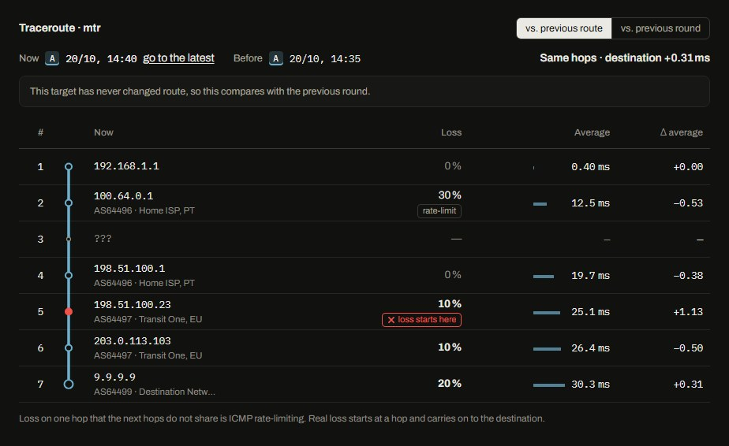
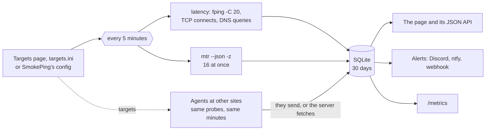

# How smoketrace works

## Reading the screen

A target's chart is three bands on one time axis:

- **Latency**: the line is the median of each round; the grey smoke behind it is its 20 pings, darker towards the
  middle. A thin, flat band is a healthy link, tall smoke is jitter, a lone whisker is one slow reply.
- **Loss**: the bar height is the share lost in that round; amber below the critical limit, red from it.
- **Route**: one letter per path (A, B, C…), kept for the target's whole history, so A coming back is still A.
  A line in the new route's colour marks each change across all three bands.

Click any moment (or <kbd>←</kbd> <kbd>→</kbd> and <kbd>Enter</kbd>) for its traceroute, against the **previous
route** (the default) or the **previous round**. The moment is kept in the address, so back, reload and a shared
link show the same one.

- The **route lines** beside the hops: one line where both routes pass through the same router, two side by side
  where they part, a red station where real loss starts, a small hollow one for a hop that never answers.
- **rate-limit**: loss on a hop that the next hops do not share. That router answers ICMP slowly or not at all;
  the packets going through it are fine.
- **loss starts here**: the first hop from which the loss lasts to the last hop that answers. The problem is that
  hop, or the link into it.
- `???` is a hop that never answers ICMP. That is normal, and it never counts as a route change.
- Under every address: its AS and operator. "AS path changed" in the summary means the path now crosses other
  networks, not just other routers.
- When the destination stops answering, the page says which hop answered last.

## The rounds

- **One round, one window.** Latency and traceroutes start together, so they describe the same minutes.
- **Latency** uses SmokePing's numbers: 20 samples a round, one a second; fping with SmokePing's own flags
  (`-C 20 -q -B1 -r1 -i10`). Each round keeps the median, the loss, the jitter (the mean difference between
  consecutive replies) and the 20 sorted replies for the smoke.
- **The same route** means the same IP at every TTL. A silent hop matches anything, so routers that skip ICMP now
  and then do not fake a change.
- **Hundreds of targets.** At most 16 mtr run at once (`TRACE_PARALLEL`): each one's raw socket sees every ICMP
  reply of the others, so the CPU they need grows with the square of how many run together. When the targets do not
  all fit in a round, each is traced in turn every few rounds, and a target that lost packets is traced the next
  round as well, while there is room. The page and `/metrics` are computed once per round, however many people look.
- **AS numbers** come from mtr (`-z`, which asks Team Cymru over DNS); their names are looked up once and kept.
  `ASN=0` turns both off.
- **Rows, not RRD.** Raw rounds stay in SQLite for 30 days; longer chart ranges are bucketed as they are read (600
  points at most), so the smoke of a 30-day view is still the real spread.
- **Every source is kept apart.** The server's own probe and each agent have their own rows, routes and route
  letters; an agent's round is checked field by field before it is stored, and an agent checks every target it is
  given before it reaches a probe.
- **Status** comes from the last round: down at 100 % loss, critical from 20 %, warning from 10 % or when the
  median runs well above its 24-hour baseline (or over `latency_warn`), no data after three missed rounds.
- **Alerts** wait for a change to hold for two rounds, so one bad round, or one odd trace, does not wake anyone up.

## API

| Endpoint | Returns |
| --- | --- |
| `GET /api/board?range=86400&src=…` | the overview in one answer: every target now and its heatmap row, the problems and the hops they share, the timeline, the version |
| `GET /api/minis?ids=…&range=…&src=…` | small charts for the cards on screen |
| `GET /api/compare?id=…&range=…` | a target's median and loss from every source that probes it |
| `GET /api/overview?src=…` | every target as one source sees it, plus each source's status for it |
| `GET /api/target?id=…&range=86400&src=…` | points `[ts, median, loss, jitter, smoke]`, route segments, limits |
| `GET /api/trace?id=…&ts=…&vs=route&src=…` | the traceroute at `ts` (the latest without it), the one it is compared with (`vs=route` or `round`), the hop-by-hop diff and the AS names |
| `GET /api/targets` | the target list, where it comes from, and whether it can be edited here |
| `POST /api/targets` | `{"op": "save", "id": …, "group", "name", "address", "slaves", "master", "loss_warn", "loss_crit", "latency_warn"}` or `{"op": "delete", "id": …}`; signed in, `Content-Type: application/json` |
| `GET /metrics` | Prometheus text format |
| `GET /api/agent/targets`, `POST /api/agent/push` | for agents that send, with `Authorization: Bearer <token>` |
| `POST /api/agent/pull` (on an agent with `LISTEN`) | for the server, with the agent's token |

## Limits

- mtr cannot pin a flow, so ECMP (several equal-cost paths) can show as routes taking turns; `ALERT_ROUTES=0`
  keeps such flaps out of your alerts.
- No HTTP (Curl) probe yet.
- The password protects the page; put it behind HTTPS if it leaves your network.
